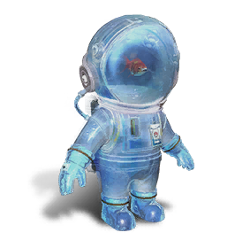

Электрический угорь  
Шефозавр Рекс  
Берсеркозавр Рекс  
Пчёлка-жужжалка  
H37  
Послушный зайчик  
Щелкунчик  
Бобёр-дровосек  
Дигби-бой  
Ребекка  
Гриборост  
Человек дождя  
Эссенция пламени  
Кот из другого измерения  
Бумажная кукла  
Рыба-гидронавт  
Джентльмен кролик  
Газоккио  
Комок смолы  
Коробка желаний  
Директор Фокс  
Доктор Ворон  
Дуэт  
Лабрадор  
Блэкбэк  
Доберман  

    
## Рыба-гидронавт
**Назначение и рекомендации:**  
Применяется для ускорения работы очистительного аппарата для воды.  
**Способы получения:**  
Встречается среди добычи встречается среди добычи в SILO "EX1" (Сценарий "Путь Зимы").  
**Рекомендации по способностям:**  
...  

----------

    
## Смертоносный кролик
**Назначение и рекомендации:**  
Пассивная добыча различного вида шкур и мяса. Не может принести чистое мясо. Рекомендуется устанавливать среднем этапе игры.  
**Способы получения:**  
С некоторой вероятностью можно получить после убийства кролика на любом сценарии. Дополнительно встречается среди добычи в SILO "Сигма" (Сценарий "Манибус").  
**Рекомендации по способностям:**  
...  
