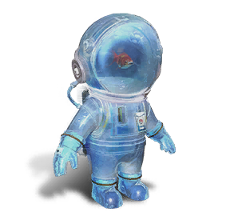

    
## Рыба-гидронавт
Мудрость - это одновременно благословение и проклятие.  
Тот мир, который она знала, не терпит глупостей, но продолжает ли она мечтать о море?  

**Назначение и рекомендации:**  
Применяется для ускорения работы очистительного аппарата для воды.  
**Способы получения:**  
Встречается среди добычи встречается среди добычи в SILO "EX1" (Сценарий "Путь Зимы").  
**Рекомендации по способностям:**  
...  
